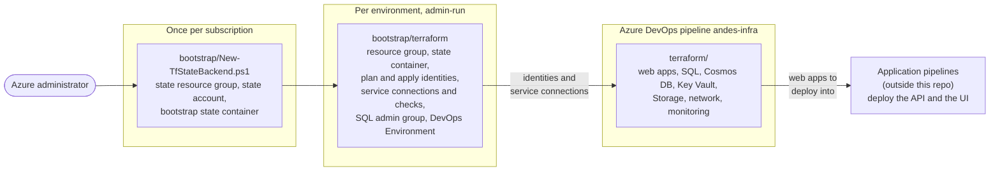
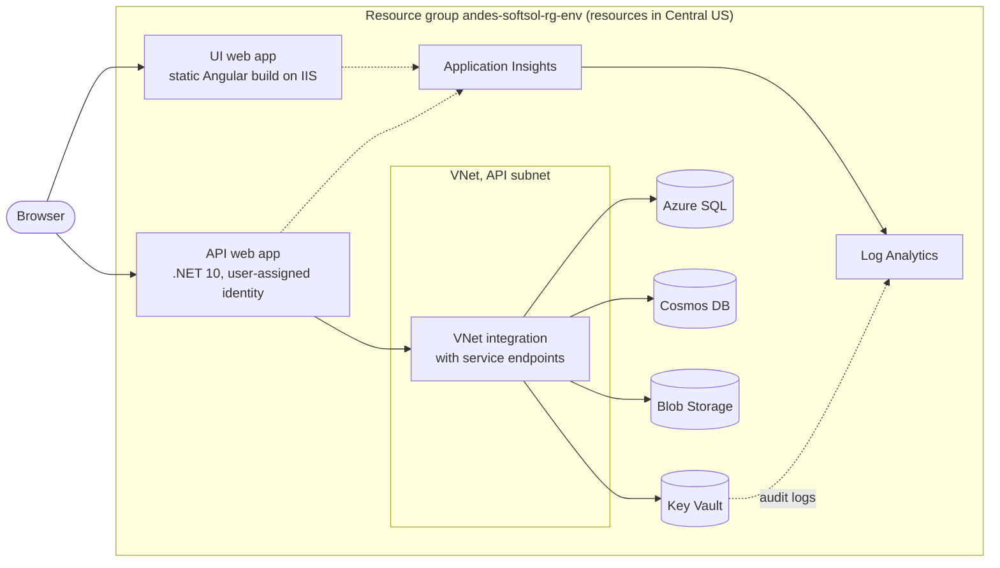

# Andes Azure infrastructure

Terraform and Azure DevOps pipelines that build and maintain the Andes Software Solutions application environments on Azure: `dev`, `qa`, `uat`, `staging` and `prod`. Each environment gets the same stack: a .NET 10 API and an Angular 22 UI on App Service, Key Vault, Azure SQL, Cosmos DB, Blob Storage and Application Insights. No secrets exist anywhere in the design. The pipeline signs in with workload identity federation and the API reaches its data through a managed identity.

This repository holds infrastructure only. Application code and the pipelines that deploy it live elsewhere.

## How it fits together

Setup happens in layers. An administrator creates the first two by hand, because a pipeline can't create the identities it needs to run. The pipeline then builds everything else.



At runtime, each environment looks like this:



The data services keep public endpoints, but their firewalls admit only the API's subnet and the IPs in `allowed_ip_addresses`. See [Architecture](docs/architecture.md) for the reasoning.

## Environments

| Environment | Resources run in | Promotion approval |
| --- | --- | --- |
| `dev` | Central US | None. Applies automatically after a merge to `main` |
| `qa` | Central US | Approval on the `andes-softsol-qa` Azure DevOps Environment |
| `uat` | Central US | Approval on the `andes-softsol-uat` Azure DevOps Environment |
| `staging` | Central US | Approval on the `andes-softsol-staging` Azure DevOps Environment |
| `prod` | Central US | Approval on the `andes-softsol-prod` Azure DevOps Environment |

Resource-group metadata and the Terraform state account stay in East US 2. See [the region split](docs/architecture.md#the-east-us-2-and-central-us-split) for why.

All five environments use dev's settings today, so `prod` is not production-hardened. Read [Production readiness](docs/production-readiness.md) before you put real data in it.

## Start here

| You are... | Read |
| --- | --- |
| New to Terraform | [Terraform primer](docs/terraform-primer.md) |
| An architect reviewing the design | [Architecture](docs/architecture.md), then [Production readiness](docs/production-readiness.md) |
| A DevOps engineer standing up or rebuilding an environment | [Manual deployment](docs/manual-deployment.md) |
| A DevOps engineer changing the pipeline | [Pipeline](docs/pipeline.md) |
| A DevOps engineer on call | [Operations](docs/operations.md) |
| A software engineer connecting an app to these resources | [Application integration](docs/application-integration.md) |
| Deciding whether prod is ready | [Production readiness](docs/production-readiness.md) |

## Repository layout

| Path | Purpose |
| --- | --- |
| `terraform/` | The root module every environment shares. Per-environment values live in `terraform/environments/<env>/{backend.hcl,terraform.tfvars}`. |
| `bootstrap/` | Admin-only. The pipeline never runs it. `New-TfStateBackend.ps1` creates the state backend once per subscription. |
| `bootstrap/terraform/` | A second root module with its own admin-only state. One `environments` entry creates an environment's resource group, state container, plan and apply identities, SQL admin group, and Azure DevOps service connections, checks and Environment. |
| `scripts/` | Scripts the pipeline runs after apply (the SQL contained user for the API identity). |
| `pipelines/` | Azure DevOps YAML: `infra-pipeline.yml` plus `templates/`. |
| `docs/` | The guides above. |

## Prerequisites

You need these only to work on the repo locally. The pipeline installs its own Terraform.

| Tool | Version | Used for |
| --- | --- | --- |
| Terraform | `>= 1.15.0, < 2.0.0` (the pipeline pins 1.16.5) | Both root modules |
| PowerShell | 7.4 or later | `bootstrap/New-TfStateBackend.ps1`, `scripts/Grant-SqlManagedIdentityAccess.ps1` |
| Az PowerShell modules | `Az.Accounts`, `Az.Resources`, `Az.Storage`; add `Az.Sql` and `SqlServer` for a local SQL grant | The scripts above |
| Azure CLI | Current | Terraform sign-in (`az login`) and object ID lookups |
| PSScriptAnalyzer | Current | Linting the PowerShell scripts |
| GitHub CLI (`gh`) | Current | Branch protection (see [Pipeline](docs/pipeline.md#branch-protection-on-main)) |

Terraform downloads these providers on `init`: `hashicorp/azurerm` `~> 5.9` (locked at 5.9.0 in both modules), plus `hashicorp/azuread` `~> 3.10` (3.10.0) and `microsoft/azuredevops` `~> 1.16` (1.16.0) in `bootstrap/terraform/`.

Deploying needs an Azure subscription and an Azure DevOps organization. [Manual deployment](docs/manual-deployment.md#part-1-prerequisites-and-permissions) lists the permissions.

## Validate your changes

Run these from the repository root before you open a PR:

```powershell
terraform -chdir=terraform fmt -check -recursive
terraform -chdir=terraform init -backend=false
terraform -chdir=terraform validate
terraform -chdir=bootstrap/terraform fmt -check
terraform -chdir=bootstrap/terraform init -backend=false
terraform -chdir=bootstrap/terraform validate
Invoke-ScriptAnalyzer -Path bootstrap -Recurse; Invoke-ScriptAnalyzer -Path scripts -Recurse
```

If `validate` fails with `Error loading state: ... lookup <account>.blob.core.windows.net: no such host`, the module's local `.terraform/` cache still points at a state account that no longer exists (after a teardown, say). Validate offline in a throwaway data directory instead; see [Operations](docs/operations.md#validate-fails-with-no-such-host).

After you change provider versions, run `terraform providers lock -platform=linux_amd64 -platform=windows_amd64` in both `terraform/` and `bootstrap/terraform/`, and commit each `.terraform.lock.hcl`. Keep the azurerm version the same in both.

## Conventions

- **Names.** Every resource is `andes-softsol-<type>-<env>`; storage accounts drop the dashes (`andessoftsolst<env>`). Names come from `local.names` in `terraform/locals.tf`, so don't hard-code them elsewhere. There are no hash or random suffixes.
- **No secrets.** Data services use managed identity and Entra RBAC. Shared keys, Cosmos DB keys and SQL authentication stay disabled.
- **Roles.** Every Azure RBAC role `terraform/` assigns must be in `assignable_role_names` in `bootstrap/terraform/variables.tf`. An ABAC condition on each apply identity enforces that list.
- **Service connections.** PR and plan stages use the read-only `<prefix>-sc-<env>-plan` connection. Only apply and the SQL grant use `<prefix>-sc-<env>-apply`. Never point a plan step at the apply connection.
- **Approvers.** They live in Azure DevOps on each Environment, never in Terraform.
- **New environments.** Add an `environments` entry in `bootstrap/terraform/terraform.tfvars`, a `terraform/environments/<env>/` folder and a pipeline template call. Don't fork Terraform code.
- **Plan refresh permissions.** If `terraform/` starts using a resource whose refresh calls a POST list action, add that action to `azurerm_role_definition.plan_reader` in `bootstrap/terraform/rbac.tf`, or plans fail with `AuthorizationFailed`.

## Contributing

1. Branch from `main`.
2. Make your change and run the [validation commands](#validate-your-changes).
3. Add one entry under `## [Unreleased]` in [CHANGELOG.md](CHANGELOG.md), in the matching subsection. Keep it reader-facing: what changed and why it matters.
4. Open a pull request into `main`. Every PR runs the `andes-infra` pipeline, which plans all five environments with read-only identities and changes nothing.
5. Merge once the required `andes-infra` check passes. If the merge touches `terraform/`, `pipelines/` or `scripts/`, the pipeline runs on `main`: it applies dev, then promotes through the later environments as approvers approve. Merges that touch only docs or `bootstrap/` start no run.

Read the PR plans. A plan shows exactly what the merge will create, change or destroy. [Pipeline](docs/pipeline.md) explains the stages and the branch protection.

## This is a public repository

Nothing in it is a secret. The `terraform.tfvars` files hold non-secret identifiers (subscription ID, Entra object IDs, Azure DevOps organization and project names) and, by the owner's choice, an allowlisted public IP. The pipeline YAML holds service connection IDs, which are not credentials. State, plans and any other `*.tfvars` are gitignored.

Pull requests from forks don't build: [Pipeline](docs/pipeline.md#fork-safety) explains why that setting must stay off.
