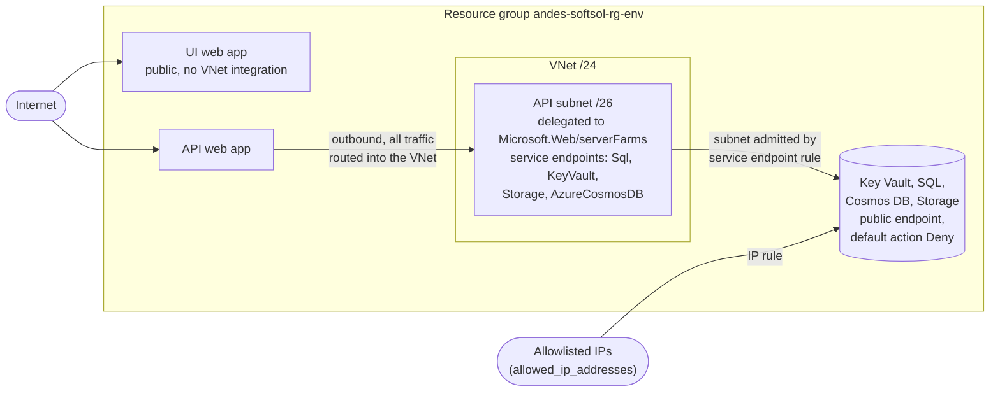

# Architecture

This guide explains what each environment contains, how it's networked and secured, and which trade-offs the team accepted on purpose. It's written for architects and reviewers. For the commands, see [Manual deployment](manual-deployment.md) and [Pipeline](pipeline.md).

The design has three goals:

1. **Every environment is the same shape.** One Terraform root module builds all of them; only the values differ.
2. **No secrets exist.** Humans and pipelines sign in with Entra ID and workload identity federation. The API uses a managed identity. Keys and passwords are disabled at the service.
3. **A pipeline can't grant itself more power.** Plan and apply use separate identities, and the apply identity is boxed in by an ABAC condition.

## What each environment contains

The repo defines five environments (dev, qa, uat, staging, prod). Each gets the resources below, named with the `andes-softsol` prefix (`name_prefix`). All five use the same sizing today.

| Component | Resource | Notes |
| --- | --- | --- |
| .NET 10 API | Windows web app `andes-softsol-api-<env>` | .NET 10 on a 64-bit worker, user-assigned identity, outbound VNet integration, health check `/health`. HTTPS only, TLS 1.2, FTPS and FTP/WebDeploy basic auth disabled |
| Angular 22 UI | Windows web app `andes-softsol-ui-<env>` | Static build served by IIS (needs `web.config`, see [Application integration](application-integration.md#ui-webconfig)). No identity, no VNet integration |
| Hosting plan | `andes-softsol-asp-<env>` | Windows, B1 in every environment, one plan per environment, shared by both apps |
| API identity | `andes-softsol-id-api-<env>` | The only credential the API uses: no keys, passwords or connection-string secrets |
| Secrets | Key Vault `andes-softsol-kv-<env>` | RBAC mode, for third-party secrets you add. Terraform writes no secrets into it |
| Relational data | Azure SQL `andes-softsol-sql-<env>` / `andes-softsol-sqldb-<env>` | Basic tier, Entra-only authentication |
| Documents | Cosmos DB `andes-softsol-cosmos-<env>` | NoSQL API, serverless, keys disabled. Database `andes` |
| Files | Storage `andessoftsolst<env>` | Geo-redundant (GRS), shared keys disabled |
| Telemetry | Application Insights `andes-softsol-appi-<env>` and Log Analytics `andes-softsol-log-<env>` | One Application Insights instance shared by the API and the UI |
| Network | VNet `andes-softsol-vnet-<env>`, subnet `andes-softsol-snet-api-<env>` | Outbound path from the API to the data services only |
| Budget (optional) | `andes-softsol-budget-<env>` | Created only when `monthly_budget_amount` is above zero. It's commented out in every tfvars file |

Alongside the environments, the admin-only layers create:

| Layer | Resources |
| --- | --- |
| `New-TfStateBackend.ps1` | `andes-softsol-rg-tfstate` (with a `CanNotDelete` lock), state account `andessoftsolsttfstate`, container `tfstate-bootstrap` |
| `bootstrap/terraform` | Per environment: resource group `andes-softsol-rg-<env>`, state container `tfstate-<env>`, plan and apply identities, service connections and checks, SQL admin group, Azure DevOps Environment. Shared: custom role `andes-softsol-terraform-plan-reader`, resource provider registrations |

## Network design

- **Web apps are public.** The API and the UI each have an `azurewebsites.net` hostname. The API's `cors` allows the UI's origin plus anything in `api_cors_allowed_origins`.
- **The API reaches data through its subnet.** VNet integration puts the API's outbound traffic on a delegated subnet that carries service endpoints for `Microsoft.Sql`, `Microsoft.KeyVault`, `Microsoft.Storage` and `Microsoft.AzureCosmosDB`. Each data service's firewall admits that subnet. The VNet is outbound-only: nothing inbound uses it.
- **Why not IP rules alone?** Azure Storage IP rules can't admit an App Service in the same region, so IP allowlisting alone would lock the API out.
- **Humans and tools get in by IP.** Key Vault, Storage, SQL and Cosmos DB keep public endpoints with the default action set to deny. `allowed_ip_addresses` in each environment's `terraform.tfvars` lists the public IPs that may pass. Key Vault and Storage also bypass the firewall for trusted Azure services.
- **The allowlist is validated.** `allowed_ip_addresses` has no default, so a run that omits it fails instead of silently removing everyone's firewall access. Pass `[]` to allow no IPs. Validation rejects `/31` ranges, `0.0.0.0/8` (SQL and Cosmos DB treat `0.0.0.0` as "all Azure datacenters"), loopback, link-local and private ranges (Storage rejects private ranges at apply time).
- **Private endpoints aren't used yet.** [Production readiness](production-readiness.md#network-and-private-endpoints) covers what they'd take.

### Address plan

Each environment's `vnet_address_space` is a distinct `/24`, and the API subnet is the first `/26` of it. Distinct ranges keep the VNets peerable later.

Windows App Service workers on B1, S1 and P1 use `10.10.0.0/19` and `10.11.0.0/19` (other SKUs use other ranges) as infrastructure IPs, and a Windows app can't reach a destination in those ranges through VNet integration ([Windows worker IP overlap](https://learn.microsoft.com/azure/app-service/overview-vnet-integration#windows-worker-ip-address-overlap)). That's harmless with service endpoints but fatal for the first private endpoint. The plan below is clear of every range Microsoft lists for any SKU. Microsoft says the ranges can change, so re-check the table when you change SKU.

| Environment | `vnet_address_space` | API subnet |
| --- | --- | --- |
| dev | `10.100.0.0/24` | `10.100.0.0/26` |
| qa | `10.101.0.0/24` | `10.101.0.0/26` |
| uat | `10.102.0.0/24` | `10.102.0.0/26` |
| staging | `10.103.0.0/24` | `10.103.0.0/26` |
| prod | `10.104.0.0/24` | `10.104.0.0/26` |

## Naming rules

Every name follows `andes-softsol-<type>-<env>`, built in one place (`local.names` in `terraform/locals.tf`). Storage account names drop the dashes (`andessoftsolst<env>`, state account `andessoftsolsttfstate`). Names are fixed: there are no hash or random suffixes, so the same environment always gets the same names.

| Rule | Value | Why |
| --- | --- | --- |
| `name_prefix` | 2-13 lowercase letters, digits or single dashes | Keeps Key Vault names within 24 characters |
| Environment name | 2-7 lowercase letters | Same |
| Key Vault name | `<prefix>-kv-<env>`, 24 characters maximum | `andes-softsol-kv-staging` is exactly 24: 13 + `-kv-` (4) + 7 |
| Storage account name | `<prefix without dashes>st<env>`, 24 characters maximum, lowercase letters and digits | A 13-letter prefix plus `st` plus a 7-letter environment is 22 |

Web app, Key Vault, Storage, SQL server and Cosmos DB names are unique across all of Azure, so a name can already be taken by someone else or by a soft-deleted resource. [Operations](operations.md#add-an-environment) shows how to check before you add an environment.

## Identity and RBAC model

Each environment has two pipeline identities, and the split is the main control. Pull request branches run their own pipeline YAML before anyone reviews it, so anyone who can push a branch can run code as whatever identity PR plans use. PR plans therefore get a read-only identity; only `main` runs get the write-capable one. Microsoft's guidance says the same: use a separate read-only identity for plan, and put approvals on the service connection, not the environment, because environment checks "can be bypassed in code" ([CAF: DevOps security](https://learn.microsoft.com/azure/cloud-adoption-framework/ready/considerations/security-considerations-overview)). This repo follows the first half of that advice and makes a deliberate exception to the second; see [Accepted trade-offs](#accepted-trade-offs).

| Who | Can do | Scope |
| --- | --- | --- |
| Azure administrator | Runs `New-TfStateBackend.ps1` and `bootstrap/terraform`: creates resource groups, identities, service connections, checks, Entra groups and role assignments | Subscription Owner, Entra Groups Administrator (or higher), Azure DevOps project administrator |
| Plan identity `andes-softsol-id-ado-<env>-plan` | Read everything Terraform refreshes (custom role `andes-softsol-terraform-plan-reader`: `*/read` plus four list actions the azurerm provider calls) and read state (Storage Blob Data Reader). Can't write resources or take the state lease | `andes-softsol-rg-<env>` and `tfstate-<env>` only |
| Apply identity `andes-softsol-id-ado-<env>-apply` | Contributor; Role Based Access Control Administrator limited by an ABAC condition (below); Storage Blob Data Contributor on state; member of the SQL admin group | `andes-softsol-rg-<env>` and `tfstate-<env>` only |
| State contributors (`state_contributor_object_ids`) | Read and write Terraform state, to run Terraform locally | That environment's `tfstate-<env>` container |
| API identity `andes-softsol-id-api-<env>` | Key Vault Secrets User, Storage Blob Data Contributor, Cosmos DB Data Contributor (database scope), SQL `db_datareader` and `db_datawriter` | That environment's resources |
| Developers (`developer_principal_ids`, set for dev only) | Key Vault Secrets Officer, Storage Blob Data Contributor, Cosmos DB Data Contributor (database scope) | Dev resources |
| SQL admins (`andes-softsol-sg-sql-admins-<env>`) | SQL Entra admin | That environment's SQL server |

The plan and apply identities live in `andes-softsol-rg-tfstate`, outside the resource group they manage, so a pipeline can't modify or delete its own identity.

### The ABAC-constrained apply identity

The apply identity must assign roles, because `terraform/` creates role assignments for the API identity and for developers. Giving it Owner or User Access Administrator would let it grant itself anything. Instead it holds Contributor plus **Role Based Access Control Administrator with an ABAC condition** ([Delegate Azure access management](https://learn.microsoft.com/azure/role-based-access-control/delegate-role-assignments-overview)). The condition, defined in `bootstrap/terraform/rbac.tf`, says that a role assignment can be written or deleted only if both are true:

- The role is in `assignable_role_names` (`bootstrap/terraform/variables.tf`): Key Vault Secrets Officer, Key Vault Secrets User, Monitoring Metrics Publisher, Storage Blob Data Contributor and Storage Blob Data Reader.
- The principal is not one of that environment's own plan or apply identities.

So the pipeline can't grant Owner, Contributor or User Access Administrator, can't give itself data-plane access, and can't widen the plan identity. Adding a role to `terraform/` therefore takes two steps: add it to `assignable_role_names` and re-apply the bootstrap, then use it in `terraform/` ([Operations](operations.md#add-a-role-to-assignable_role_names)).

Cosmos DB data-plane roles are Cosmos DB's own role assignments (`azurerm_cosmosdb_sql_role_assignment`), not Azure RBAC role assignments, so this allowlist doesn't govern them.

### Why the pipeline stays contained

- **It can't touch its own identity or other environments.** Both identities have no rights at subscription scope, and each is scoped to one resource group and one state container.
- **No pipeline identity can tamper with admin state.** `bootstrap/terraform` keeps its state in the `tfstate-bootstrap` container, writable only by `-BootstrapAdminObjectIds`. A pipeline that could edit that state could steer the next admin-run apply.
- **The pipeline can't build its own foundations.** It can't sign in until its identities and service connections exist, has nowhere to keep state until the state account exists, and can't create the resource group. That is by design: a pipeline that could create its own identities could grant itself more access.

## Service connections and checks

Each identity is used through its own Azure DevOps service connection, authenticated by workload identity federation (no secret).

| Connection | Identity | Used by | Checks |
| --- | --- | --- | --- |
| `andes-softsol-sc-<env>-plan` | Plan | PR plans and `main` plans | None |
| `andes-softsol-sc-<env>-apply` | Apply | Apply and SQL grant (`main` only) | Branch control (`refs/heads/main` only, display name "Only main can apply") and exclusive lock |

- **PR branches can't run code with write access.** Plans use the read-only connection, which carries no checks, so PR runs aren't blocked. Branch control and the exclusive lock sit on the apply connection, where pipeline YAML can't remove them ([Define approvals and checks](https://learn.microsoft.com/azure/devops/pipelines/process/approvals)).
- **Approvals sit on the Environment `andes-softsol-<env>`,** not on the connection. The Environment also records deployment history. See [Accepted trade-offs](#accepted-trade-offs).
- **Branch control doesn't read GitHub.** The check is created with `verify_branch_protection = false`, because branch protection lives in GitHub, which the check can't inspect. [Pipeline](pipeline.md#branch-protection-on-main) covers the GitHub side.
- **Connections are created unverified.** The federated credential's subject embeds the connection's GUID, so the credential can only be created after the connection exists. The bootstrap reads the issuer and subject from the connection and creates the credential in the same apply.

## Data protection settings

| Service | Settings |
| --- | --- |
| Terraform state account `andessoftsolsttfstate` | Entra authentication only (shared keys disabled), TLS 1.2, no public blob access, RA-GRS, versioning, 30-day blob and container soft delete, `CanNotDelete` lock on its resource group. The network stays open because Microsoft-hosted agents use dynamic IPs; RBAC per container is the control |
| Key Vault | RBAC authorization, firewall default deny (allowlisted IPs plus the API subnet), soft delete 7 days, purge protection off, audit logs to Log Analytics |
| Storage `andessoftsolst<env>` | Shared keys, local users and public blob access disabled; TLS 1.2; HTTPS only; cross-tenant replication off; GRS; versioning on; blob and container soft delete 7 days (hard-coded in `storage.tf`); firewall default deny |
| Azure SQL | Entra-only authentication, TLS 1.2, Basic tier, 2 GB, `Local` backup redundancy, 7-day point-in-time restore |
| Cosmos DB | Keys disabled (Entra data-plane roles only), TLS 1.2, Session consistency, continuous backup (`Continuous7Days`), single region |
| Application Insights | Local authentication stays enabled, because the Angular browser SDK can only send telemetry with the connection string. Microsoft doesn't treat that connection string as a secret |
| Log Analytics | `PerGB2018`, 30-day retention, 1 GB per day cap in every environment |

Settings that differ between environments are listed in [Production readiness](production-readiness.md).

## The East US 2 and Central US split

All environment resources run in Central US (`location` in each `terraform.tfvars`). The Terraform state account (the `-Location` you pass `New-TfStateBackend.ps1`), the pipeline identities (created in the state account's region) and each environment's resource-group metadata (`location` in `bootstrap/terraform/terraform.tfvars`) stay in East US 2, because a resource can live in a different region from its resource group.

The reason is capacity, not preference. The first apply in East US 2 hit two subscription-level restrictions: Azure refused to create SQL servers there (`ProvisioningDisabled: Provisioning is restricted in this region`), and the subscription had no App Service Basic (B1) quota. Central US has both. Moving the resource groups would replace them, which `prevent_destroy` blocks, so they stay put. [Operations](operations.md#apply-fails-with-a-quota-or-provisioningdisabled-error) has the checks to run before picking a region for a new subscription.

## Accepted trade-offs

Each of these was a deliberate choice. Review any change that touches them with that in mind.

### Approvals live on Azure DevOps Environments, never in Terraform

Approvers belong to the pipeline, not to Terraform, so the bootstrap creates each Environment with no approvers and an administrator adds them by hand. Two consequences:

- **A recreated Environment has no approval.** Until someone adds one, its applies run automatically, prod included. Confirm the approver after any rebuild.
- **YAML can drop the approval.** Microsoft advises putting approvals on the service connection because environment checks can be bypassed in code. A change merged to `main` that removed the `environment:` key from the apply job would skip the approval. Branch control still keeps PR branches away from the apply connection, so such a change has to pass the `andes-infra` check on a PR and merge to `main` before it can run. Review any change to `pipelines/` with that in mind.

### Prod shares the subscription

The team keeps prod in the same subscription as the other environments, against CAF's guidance to use separate subscriptions for production and nonproduction ([CAF: Create and scale Azure subscriptions](https://learn.microsoft.com/azure/cloud-adoption-framework/ready/azure-setup-guide/initial-subscriptions#start-with-subscription-policies)). That means:

- Subscription Owners and Contributors, and subscription-scope policy, also control prod.
- Subscription-level Defender for Cloud plans would cover (and bill) every environment.
- Prod and non-prod share `andes-softsol-rg-tfstate` and the state account.

Mitigations: per-environment identities scoped to their own resource group and state container, and an approval on prod's Environment. Keep the subscription Owner list short. [Production readiness](production-readiness.md#shared-subscription) covers moving prod out.

### Public endpoints behind an IP allowlist

Key Vault, Storage, SQL and Cosmos DB keep public endpoints, restricted to the API's subnet and the allowlisted IPs. Private endpoints would remove the public path, but they change the pipeline: Microsoft-hosted agents can't reach them. See [Production readiness](production-readiness.md#network-and-private-endpoints).

### Fixed names with no random suffixes

Names are deterministic, so the same environment always gets the same names and docs, scripts and pipelines can rely on them. The cost is that global names can collide with something already in Azure, and that a deleted Key Vault or Log Analytics workspace holds its name until it's purged or recovered. You check availability before adding an environment instead of adding a suffix.
