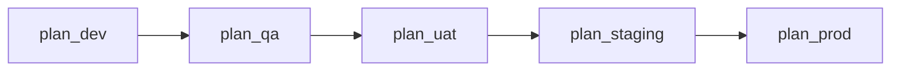
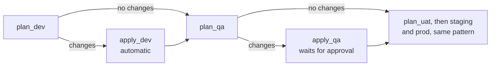

# Pipeline

`pipelines/infra-pipeline.yml` plans every environment on each pull request and, after a merge to `main`, applies them in order with approvals. This guide explains what runs when, which identity each step uses, how promotion and branch protection work, and how to change the pipeline safely.

The design goal is that **code from an unreviewed branch can never write to Azure**. Everything below follows from that.

## Triggers

| Trigger | When it fires | What it does |
| --- | --- | --- |
| CI on `main` | A push to `main` that touches `terraform`, `pipelines` or `scripts`, with `batch: false` | Plans, then applies and promotes |
| PR into `main` | **Every** pull request into `main`. There is no path filter | Plans only |

- **The PR trigger has no path filter on purpose.** `main`'s branch protection requires the `andes-infra` check. A PR the trigger skipped could never report that check and could never merge.
- **Runs aren't batched.** Azure DevOps won't start a batched run until the current one completes, and a run waiting at an approval is still running, so batching would hold every later merge back from dev.
- **The `pr:` trigger works for GitHub and Bitbucket repos only.** With Azure Repos you'd add the pipeline as a build validation branch policy instead.
- **The pool is `ubuntu-24.04`** (Microsoft-hosted).

## Stage flow

Per environment, `pipelines/templates/terraform-environment.yml` defines two stages. `infra-pipeline.yml` chains the environments in order: dev, qa, uat, staging, prod. Each template call after dev sets `dependsOn: [apply_<previous>]`.

On a pull request, every `apply_<env>` stage is skipped, so the run is a series of plans:



On `main`, each environment plans, then applies only when its plan has changes. A stage with no changes is skipped, so it asks for no approval:



### Stage and job detail

| Stage / job | Steps | Service connection | Identity |
| --- | --- | --- | --- |
| `plan_<env>` / `plan` | `terraform fmt -check -recursive`, `init`, `validate`, `plan -lock=false -detailed-exitcode`; publishes the plan artifact (`main` only) | `andes-softsol-sc-<env>-plan` | Plan identity (read-only) |
| `apply_<env>` / `apply` (a `deployment` job on the Environment `andes-softsol-<env>`) | Download the plan artifact, `init`, `apply -lock-timeout=5m` on the saved plan | `andes-softsol-sc-<env>-apply` | Apply identity |
| `apply_<env>` / `grant` | Read `sql_access` from the outputs; create the API's contained database user with `scripts/Grant-SqlManagedIdentityAccess.ps1 -AddRunnerFirewallRule` | `andes-softsol-sc-<env>-apply` | Apply identity, as a member of the SQL admin group |

Terraform is installed by `steps-install-terraform.yml` and run by `steps-terraform.yml`, which signs in with workload identity federation. The azurerm provider and backend request fresh OIDC tokens themselves, so long applies outlive the short-lived federated token. The `grant` job installs the pinned `SqlServer` module (`sqlServerModuleVersion`).

**Plan details**

- **`-lock=false`.** The plan identity can read state but can't take the lease. Apply still locks, and Terraform rejects a stale saved plan.
- **The plan artifact `tfplan-<env>` is published only on `main`,** and only when the plan has changes. Saved plans hold variable values in cleartext, and PR plans are never applied.
- **`hasChanges` comes from `-detailed-exitcode`.** Exit code 2 means changes, 0 means none, 1 fails the job.

**Apply-stage condition**

```yaml
condition: >-
  and(
    succeeded(),
    eq(variables['Build.SourceBranch'], 'refs/heads/main'),
    eq(dependencies.plan_<env>.outputs['plan.tfplan.hasChanges'], 'true')
  )
```

The stage runs only when the plan succeeded, the run is on `main`, and the plan found changes.

**Checks on the apply connection**

Branch control (`refs/heads/main` only) and an exclusive lock sit on `andes-softsol-sc-<env>-apply`, where pipeline YAML can't remove them. Azure DevOps evaluates the checks once per stage, before it starts, in this order: branch control, then the Environment's approval, then the exclusive lock. The YAML sets no `lockBehavior`, so the lock uses Azure DevOps' default, `runLatest`: only the latest run acquires the lock ([Define approvals and checks](https://learn.microsoft.com/azure/devops/pipelines/process/approvals)).

**Why `grant` is a separate job**

The `grant` job runs after `apply` in the same stage, so it shares the apply job's approval: checks run once per stage. It's a separate job so **Rerun failed jobs** retries a failed grant without re-applying a now-stale plan.

The `grant` job runs only when the apply stage runs, which is only when the plan has changes. If an apply fails after the database was created, fixing the cause usually leaves a no-change plan, and the grant is skipped. [Operations](operations.md#the-sql-grant-didnt-run-after-a-failed-apply) has the fix.

## Promotion and approvals

A merge applies dev automatically. Each later environment waits for its Environment's approvers, in order.

| Environment | Approval | Timeout | Approvers may approve their own runs |
| --- | --- | --- | --- |
| dev | None | n/a | n/a |
| qa | One Approval check | 30 days | Yes |
| uat | One Approval check | 30 days | Yes |
| staging | One Approval check | 30 days | Yes |
| prod | One Approval check | 30 days | Yes |

As configured today, the sole approver for each is Rodrigo Rojas, who also merges, which is why **Allow approvers to approve their own runs** stays on. Approvers are set by hand in Azure DevOps under **Pipelines → Environments → `andes-softsol-<env>` → Approvals and checks**; Terraform never manages them ([why](architecture.md#approvals-live-on-azure-devops-environments-never-in-terraform)). There is no approval YAML: the `deployment` job targets the Environment, and Azure DevOps holds the stage until an approver responds. One approval covers both the `apply` and `grant` jobs.

### What a timeout or a rejection does

Microsoft documents both outcomes ([Define approvals and checks](https://learn.microsoft.com/azure/devops/pipelines/process/approvals)): if approvals aren't completed within the timeout, the stage is marked as skipped; if you reject an approval, the stage fails.

Each `plan_<env>` stage uses `condition: and(not(failed()), not(canceled()))`. That lets the chain behave differently in the two cases:

| What happens at `apply_<env>` | Stage result | Next environment |
| --- | --- | --- |
| Approved | Succeeded | Plans and, if it has changes, waits for its own approval |
| Timed out (30 days, unanswered) | Skipped | **Still plans**, because skipped isn't failed. It then asks for its own approval |
| Rejected | Failed | **Skipped, and so are all later environments** |

So **reject a run you don't want promoted** rather than leaving it, or the next environment will still plan and ask for approval. The same condition lets PR runs plan every environment even though each previous `apply` stage is skipped.

### Approving a run

- **Review before you approve.** Read the plan in the `plan_<env>` logs first.
- **Approve the newest run and cancel older pending ones.** Approving an old run after a newer one has applied fails safely, because Terraform refuses a stale saved plan. Two quick merges can make a dev apply fail the same way; re-run the pipeline.
- A pending approval shows on the run and on **Pipelines → Environments → `andes-softsol-<env>`**.

## Branch protection on `main`

Branch protection is a GitHub setting, not code in this repo. An admin applies it once with the command below, and it stays until changed.

| Setting | Value |
| --- | --- |
| Pull request required | Yes, with 0 required approvals (one maintainer) |
| Required status check | `andes-infra`, strict (the branch must be up to date) |
| Admins | Included (`enforce_admins`) |
| Force pushes and deletions | Not allowed |

```powershell
gh auth login                                   # once, as a repository admin
$repo = 'RorroRojas3/azure-terraform'           # <owner>/<repo>
@'
{"required_status_checks":{"strict":true,"contexts":["andes-infra"]},"enforce_admins":true,"required_pull_request_reviews":{"required_approving_review_count":0},"restrictions":null,"allow_force_pushes":false,"allow_deletions":false}
'@ | gh api -X PUT "repos/$repo/branches/main/protection" --input -
```

Check it with `gh api "repos/$repo/branches/main/protection"`.

Reviews are optional while there is one maintainer, because GitHub doesn't let you approve your own PR. The required check is the safeguard: no change reaches `main` without a green plan. When a second maintainer joins, raise `required_approving_review_count` to 1. This matters most for changes to `pipelines/`, which could drop an Environment's approval (see [the trade-off](architecture.md#approvals-live-on-azure-devops-environments-never-in-terraform)).

### When the pipeline can't run

Break-glass: if the pipeline can't produce the required check (during a rebuild, say), an admin can lift admin enforcement, merge, then restore it.

```powershell
$repo = 'RorroRojas3/azure-terraform'           # <owner>/<repo>

# Let an admin merge without the check
gh api -X DELETE "repos/$repo/branches/main/protection/enforce_admins"

# Restore it straight afterwards
gh api -X POST "repos/$repo/branches/main/protection/enforce_admins"
```

During a rebuild, PR plans fail at sign-in until the bootstrap has recreated the identities, so the `andes-infra` check can't pass until then. See [Manual deployment, Part 8](manual-deployment.md#part-8-rebuild-after-a-teardown-or-lost-bootstrap-state).

## Fork safety

This is a public repository. A pipeline run from a fork PR would use the fork's own YAML, so building PRs from forks is switched off at the Azure DevOps project level (`buildsEnabledForForks: false`). **Keep it off.** Fork PRs therefore don't produce an `andes-infra` check.

Optional defense in depth: Azure DevOps can require a team member's comment before PR builds from same-repo branches run ([Sprint 275](https://learn.microsoft.com/azure/devops/release-notes/2026/pipelines/sprint-275-update#features)). The plan and apply split already keeps those builds read-only.

## Service connection lifecycle

- **100-day auto-disable.** Azure DevOps may automatically disable connections unused for 100 days ([Connect to Azure](https://learn.microsoft.com/azure/devops/pipelines/library/connect-to-azure?view=azure-devops)). A qa or prod run then fails because its service connection is disabled. Re-enable it in **Project settings → Service connections**, or run the pipeline regularly.
- **Legacy OIDC issuer.** It retires on July 1, 2027. The bootstrap reads each federated credential's issuer and subject from the Azure DevOps service connection, so if you convert a connection to the Microsoft Entra issuer, re-applying the bootstrap updates the credential ([Manually set an ARM WIF service connection](https://learn.microsoft.com/azure/devops/pipelines/release/configure-workload-identity)).

## Changing the pipeline

### Add an environment's template call

Append one call to `pipelines/infra-pipeline.yml`, with both connection IDs from the bootstrap's `service_connection_ids` output and `dependsOn` pointing at the previous environment's apply stage:

```yaml
- template: templates/terraform-environment.yml
  parameters:
    environment: qa
    planServiceConnectionId: <plan id>
    applyServiceConnectionId: <apply id>
    dependsOn: [apply_dev]
```

The template's parameters are `environment`, `planServiceConnectionId`, `applyServiceConnectionId`, `dependsOn` and an optional `namePrefix` (default `andes-softsol`). Service connection and Environment names follow the `andes-softsol-*` convention. The full procedure is in [Operations](operations.md#add-an-environment).

### Upgrade Terraform

Change `terraformVersion` and `terraformSha256` together in `infra-pipeline.yml`. The install step verifies the download against the hash and fails if they don't match. Get the hash for the Linux zip from HashiCorp's `terraform_<version>_SHA256SUMS`:

```powershell
$v = '1.16.5'
(Invoke-RestMethod "https://releases.hashicorp.com/terraform/$v/terraform_${v}_SHA256SUMS") -split "`n" |
    Select-String "terraform_${v}_linux_amd64.zip"
```

Both root modules require `>= 1.15.0, < 2.0.0` (`versions.tf`). Raise that bound only if you drop support for an older version.

### Upgrade providers

Change the version constraint, then regenerate the lock file in **both** modules and commit each `.terraform.lock.hcl`:

```powershell
terraform -chdir=terraform init -upgrade -backend=false
terraform -chdir=terraform providers lock -platform=linux_amd64 -platform=windows_amd64
terraform -chdir=bootstrap/terraform init -upgrade -backend=false
terraform -chdir=bootstrap/terraform providers lock -platform=linux_amd64 -platform=windows_amd64
```

Keep the azurerm version the same in both modules. The `linux_amd64` hash is for the pipeline agent; `windows_amd64` is for local runs.

### Rules for editing the YAML

- Never point a plan step at the apply connection.
- Don't remove the `environment:` key from the `apply` deployment job, or the approval disappears.
- Plan jobs must keep `-lock=false` and publish the artifact only on `main`.
